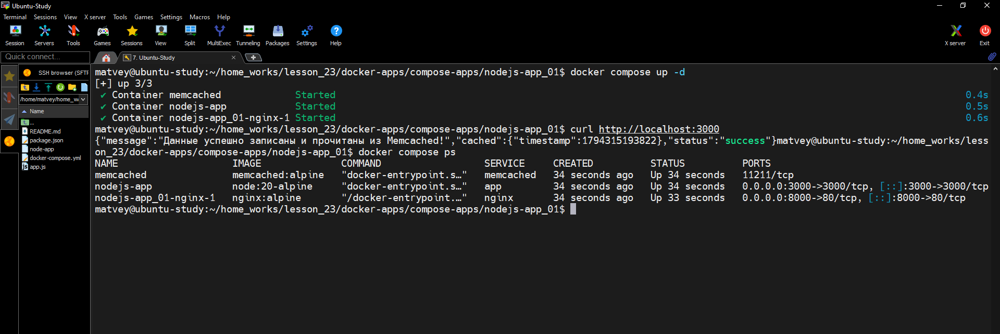
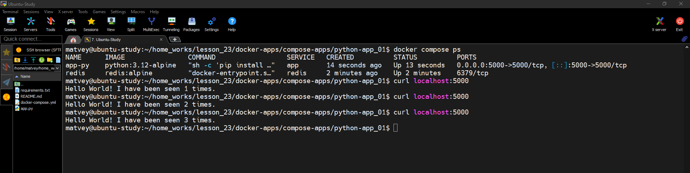

1) Запустить с помощью docker compose приложения:
   <br>https://gitlab.com/dos-29-onl/docker-apps/-/tree/main/compose-apps/nodejs-app_01?ref_type=heads</br>

 ```
services:

  memcached:
    image: memcached:alpine
    container_name: memcached


  app:
    image: node:20-alpine
    container_name: nodejs-app
    working_dir: /app
    volumes:
      - ./:/app
    ports:
        - "3000:3000"
    command: sh -c "npm install  && npm start"
    environment:
      MEMCACHED_HOST: memcached:11211
    depends_on:
      - memcached
    restart: unless-stopped


  nginx:
    image: nginx:alpine
    container_name: nginx
    ports:
      - "8000:80"
    volumes:
      - ./node-app:/etc/nginx/conf.d/default.conf:ro
    depends_on:
      - app
    restart: unless-stopped
```


  


2) Запустить с помощью docker compose приложения:
  <br>https://gitlab.com/dos-29-onl/docker-apps/-/tree/main/compose-apps/python-app_01?ref_type=heads</br>
   
```
services:

  redis:
    image: redis:alpine
    container_name: redis
    restart: unless-stopped

  app:
    image: python:3.12-alpine
    container_name: app-py
    working_dir: /app
    volumes:
        - ./:/app
    command: sh -c "pip install -r requirements.txt  && python app.py"
    ports:
        - "5000:5000"
    environment:
        REDIS_HOST: redis
    depends_on:
      - redis
    restart: unless-stopped
```




